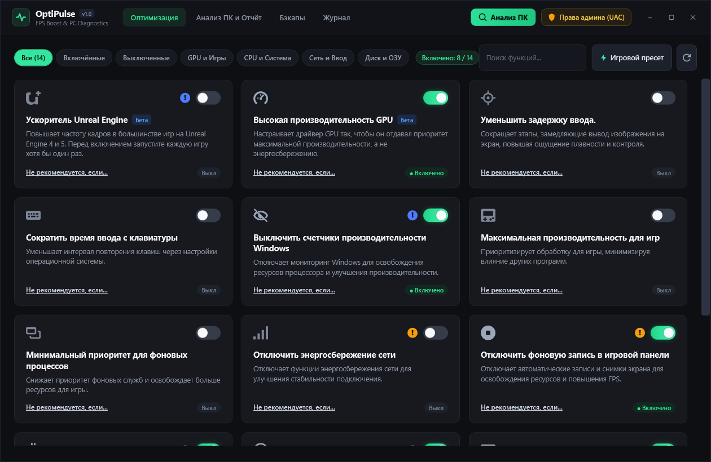

# ⚡ OptiPulse — Windows Gaming & PC Optimizer

**OptiPulse** — бесплатная утилита с открытым исходным кодом для игровой и системной оптимизации Windows 10/11, дополненная модулем **глубокого анализа ПК и формирования отчёта** с персональными рекомендациями.

> **Прозрачность и безопасность:** приложение запускается без прав администратора (`asInvoker`) для безопасного чтения настроек и анализа ПК. Повышенные права (Windows UAC) запрашиваются **только при необходимости** — при переключении системных оптимизаций. Перед каждым изменением автоматически создаётся резервная копия.

---

## 🚀 Быстрый старт

1. Перейдите в раздел **[Releases](https://github.com/bloodofdeath/boost-system/releases)**.
2. Скачайте последнюю версию `OptiPulse.exe`.
3. Запустите приложение — установка не требуется (Portable).

**Системные требования:** Windows 10 (1903+) или Windows 11 (64-bit).

---

## ✨ Возможности

### 1. Все 14 игровых и системных оптимизаций

Каждая карточка считывает реальное состояние системы в реальном времени:

| # | Оптимизация | Описание | Права админа |
|---|---|---|:---:|
| 1 | **Ускоритель Unreal Engine** | Оптимизирует профили `Engine.ini` для игр на UE4 и UE5 (предзагрузка шейдеров, отключение ресурсоёмких скрытых эффектов) | ❌ |
| 2 | **Высокая производительность GPU** | Включает аппаратное ускорение HAGS, оптимизацию оконных игр DirectX и максимальный профиль видеодрайвера | ✔ |
| 3 | **Уменьшить задержку ввода.** | Настраивает 1:1 Raw Input (отключение акселерации мыши), выставляет таймер высокого разрешения и минимизирует буферы ввода | ✔ |
| 4 | **Сократить время ввода с клавиатуры** | Устанавливает минимальную задержку и максимальную скорость повторения клавиш через системные параметры Win32 | ❌ |
| 5 | **Выключить счетчики производительности Windows** | Отключает фоновый опрос PerfMon-счётчиков, снижая лишние прерывания CPU | ✔ |
| 6 | **Максимальная производительность для игр** | Включает Windows Game Mode, приоритет MMCSS `Games` (GPU/CPU/SFIO) и отключает Power Throttling | ✔ |
| 7 | **Минимальный приоритет для фоновых процессов** | Настраивает квантование планировщика CPU в пользу активной игры (`Win32PrioritySeparation`) | ✔ |
| 8 | **Отключить энергосбережение сети** | Отключает Green Ethernet / Energy Efficient Ethernet и предотвращает засыпание сетевого адаптера | ✔ |
| 9 | **Отключить фоновую запись в игровой панели** | Полностью выключает фоновую запись и захват клипов Xbox Game Bar / Game DVR | ✔ |
| 10 | **Держать все ядра активными** | Отключает парковку ядер процессора (Core Parking), поддерживая полную готовность всех ядер | ✔ |
| 11 | **Отключить временные метки последнего доступа** | Отключает запись штампов последнего доступа к файлам NTFS для снижения нагрузки на диск | ✔ |
| 12 | **Отключить SuperFetch** | Отключает службу SysMain (рекомендуется для систем с SSD / NVMe дисками) | ✔ |
| 13 | **Отключить индексацию файлов Windows** | Останавливает и отключает фоновую службу индексирования `WSearch` | ✔ |
| 14 | **Режим максимальной производительности** | Активирует скрытую схему электропитания Windows «Максимальная производительность» (Ultimate Performance) | ✔ |

---

### 2. 🔍 Анализ ПК и рекомендации по ускорению

Кнопка **«Анализ ПК»** проводит комплексное сканирование оборудования и настроек:
- **Аппаратный аудит:** тип накопителей (SSD/NVMe vs HDD), характеристики CPU/GPU, свободная оперативная память, режим питания (ПК или ноутбук).
- **Персональные советы:** умные подсказки с учётом железа (например, предупреждение не отключать SysMain на HDD или подсказки по экономии батареи на ноутбуках).
- **Службы и телеметрия:** список фоновых служб (диагностика, телеметрия, службы отчётов об ошибках), которые можно безопасно отключить.
- **Автозагрузка:** выявление ресурсоёмких приложений, запускающихся вместе с Windows.
- **Экспорт отчётов:** сохранение полного диагностического отчёта в форматах **HTML** (интерактивный отчёт), **Markdown** и **JSON**.

---

### 3. 🛡 Безопасность и откат

- **Резервные копии:** исходные параметры реестра и конфигурационные файлы автоматически сохраняются в `%APPDATA%\OptiPulse\backups\`.
- **Точки восстановления:** создание системной точки восстановления Windows в один клик.
- **Полный откат:** возможность в любой момент вернуть все настройки к исходным значениям.
- **Прозрачный лог:** подробный журнал каждого действия во вкладке «Журнал».

---

## ⚠️ Дисклеймер

Программа изменяет системные параметры Windows для достижения максимальной производительности в играх. Перед применением твиков рекомендуется создать системную точку восстановления. Проект распространяется по лицензии MIT.
